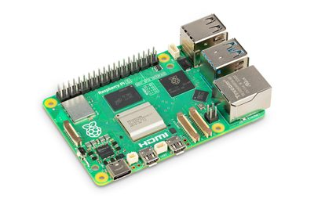
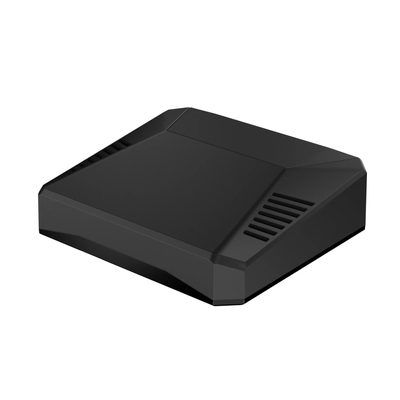
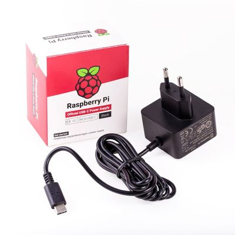
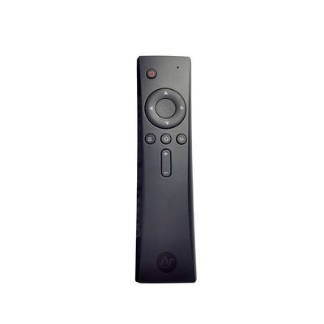

# IPTV Player for Raspberry Pi (Argon IR Remote)

A dead-simple, full-screen IPTV player. It can be controlled by the
**Argon IR Remote** (needs an IR receiver — see note below) **and** by a
**web-based virtual remote** you open from any phone, tablet or laptop on
the same network.

## Web remote & settings (works with no extra hardware)

Connect your phone, tablet or laptop to the **same Wi-Fi/LAN as the box**,
then **scan the QR code shown on the TV start page** with your camera. It
opens the web remote directly, no address to type.

(No QR code handy? Open `http://<hostname>.local:8080`, e.g.
`http://iptv1.local:8080`, or use the box's IP address with port 8080.)

You get three tabs:

- **Remote** — on-screen buttons: Power, Up, Down, Left, Right, OK,
  Back, Home, Volume +/−, Mute. (Arrow keys / Enter / Backspace / H on a
  physical keyboard work too.)
- **Play** — watch from your phone/laptop instead of the TV: pick a live
  category, or a movie/series from a poster grid (season/episode for series) and
  play it in the browser. Live TV plays in Safari (iPhone/iPad/Mac);
  other formats can be opened in **VLC** (a link or `.m3u` file is
  provided) and movies/episodes can be downloaded.
- **Settings** — edit the whole configuration (channels, provider,
  TV guide) right in the browser; changes are saved automatically and the player
  reloads automatically. Invalid YAML is rejected with an error and the
  previous config is backed up to `config.yaml.bak`.

> Note on the IR remote: the Raspberry Pi has **no built-in IR receiver**.
> The Argon remote only works if an IR receiver is connected (the Argon
> ONE case has one on GPIO23, already configured here, or add a cheap
> TSOP38238/VS1838B module to GPIO23). Until then, use the web remote.

## System requirements

| | What you need |
|---|---|
|  | **Raspberry Pi 5**, 4 GB RAM or more (8 GB is not needed). |
|  | **microSD card**, 16 GB or larger (32 GB recommended, A1/A2 rated).<br>You also need a **USB card reader** and a **computer** to flash the system image onto the card (with Raspberry Pi Imager). |
|  | **Argon ONE case**, with built-in fan, power button and IR receiver. The Argon case is optional, but a case **with a fan is not**: the Pi 5 gets hot when playing HD video. |
|  | **Official USB-C power supply** for the Raspberry Pi 5. |
|  | **Micro HDMI to HDMI cable** to connect the TV. |
|  | **Argon IR remote** (optional; the web remote works without it). |

All of these can be bought at [raspberrypi.dk](https://raspberrypi.dk/en/).

## Fresh install (new Raspberry Pi 5)

1. Flash **Raspberry Pi OS Lite (Trixie, arm64)** with Raspberry Pi Imager.
   In the advanced settings set user **`iptv`**, hostname (e.g. `iptv1`),
   Wi-Fi, locale and enable SSH.
2. Boot, connect (`ssh iptv@<hostname>.local`) and run:

   ```bash
   curl -fsSL https://raw.githubusercontent.com/easyiptvbox/easyiptvbox/main/deploy/bootstrap.sh | sudo bash
   sudo reboot
   ```

   It installs all packages, the player, services, boot splash, IR setup,
   VPN helper and the Argon ONE case software. It is safe to re-run.
3. Scan the QR code on the TV start page (or open `http://<hostname>.local:8080`) and set your provider, Wi-Fi and
   remote access in **Settings** (these are per-box and never stored in git).

## Automatic updates

Unless switched off (Settings > Software updates > checkbox), every box checks
GitHub (`main`) **every Monday ~04:00** (`iptv-update.timer`)
and applies new versions: it fast-forwards `/opt/easyiptvbox`, syncs the app
(your `config.yaml`, `remotes.json` and cache are never touched), restarts the
player and rolls back automatically if the player doesn't start.
Use **Settings > Software updates > Update now** to update immediately, or
`sudo /opt/easyiptvbox/deploy/update.sh`. Logs: `journalctl -u iptv-update`.
Only the repo owner can push to `main`. See [WHATS_NEW.md](WHATS_NEW.md) for
the changes per week (also linked from Settings).

## How to use the remote

| Button        | What it does                                  |
|---------------|-----------------------------------------------|
| Arrows ↑ ↓ ← →| Move the selection                            |
| OK            | Open a list / start a channel                 |
| Back          | Go back one screen                            |
| Home          | Return to the start page (left menu)          |
| Up / Down (while watching) | Switch to previous / next channel|
| Menu / Back (while watching) | Show the channel list again    |
| Volume + / −  | Change the volume                             |

## Screens

1. **Start page** — a thin menu on the left is always shown: **Movies**,
   **Live**, **Series** and the QR code (bottom). Up/Down in the menu
   switches the page, OK/Right enters it, Left/Back returns to the menu.
   The last used section is remembered across restarts (first run: Live).
   - **Live**: your categories as picture tiles. Open one to get its
     channels as a picture grid. Tiles show a picture you uploaded in
     *Settings > Live thumbnails*, else the grabbed frame (Menu key to
     refresh), else a colored square.
   - **Movies / Series**: a **poster grid** (pictures supplied by your
     provider, cached in `app/cache/posters`; items without a picture
     show their title).
2. **Choose an episode** — for series: seasons and episodes as lists
3. **Watching** — full-screen video

## Changing channels / provider — edit ONE file

Everything lives in **`/home/iptv/iptv-player/config.yaml`**.

- To use a paid IPTV subscription: fill in the `provider:` section
  (url + username + password) and set `enabled: true`.
- To hand-pick channels: edit the `playlists:` section.
- To add a TV guide: add XMLTV URLs under `epg: sources:`.

After editing:

```bash
ssh pi 'sudo systemctl restart iptv'
```

The test channels shipped in the config are free, public, legal streams
(Al Jazeera, France 24, DW, Red Bull TV, NASA, plus Apple/Mux test feeds).

## What was installed on the Pi

- **IR receiver**: `dtoverlay=gpio-ir,gpio_pin=23` in
  `/boot/firmware/config.txt` (Argon ONE IR is on GPIO 23).
- **ir-keytable** + keymap `/etc/rc_keymaps/argon.toml` (NEC protocol),
  auto-loaded by the `iptv-ir.service`.
- **mpv** (hardware-accelerated player, renders on DRM/KMS — no desktop
  needed), **python3-pygame** (menus), **python3-evdev** (reads the
  remote), **python3-yaml**, **python3-requests**.

## Services

| Service            | Purpose                                            |
|--------------------|----------------------------------------------------|
| `iptv-ir.service`  | Loads the Argon remote keymap at boot              |
| `iptv.service`     | Runs the player full-screen on tty1, restarts on crash |

```bash
ssh pi 'systemctl status iptv iptv-ir'
ssh pi 'journalctl -u iptv -f'      # watch the player logs
```

The player waits until an HDMI TV/monitor is actually connected before
drawing, so it is safe to leave running with the TV off.

## Adding extra remote buttons (colour/number keys)

Those aren't documented by Argon, so capture them yourself:

```bash
ssh pi 'sudo ir-keytable -s rc0 -t'   # press buttons, note "scancode = 0x.."
```

Add lines to `/etc/rc_keymaps/argon.toml`, e.g. `0x1a = "KEY_1"`, then:

```bash
ssh pi 'sudo systemctl restart iptv-ir'
```

## Files

```
app/config.yaml     the configuration you edit
app/iptv_tv.py      main application (menus + main loop)
app/iptv_config.py  config + Xtream provider + EPG (XMLTV) loading
app/iptv_player.py  controls mpv over its IPC socket
app/iptv_input.py   reads the IR remote (and HDMI-CEC / keyboard)
deploy/*.service    systemd units
deploy/capture-buttons.sh  helper to learn new remote buttons
```
